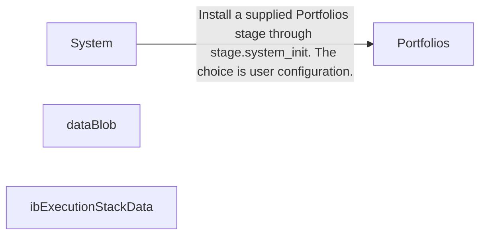
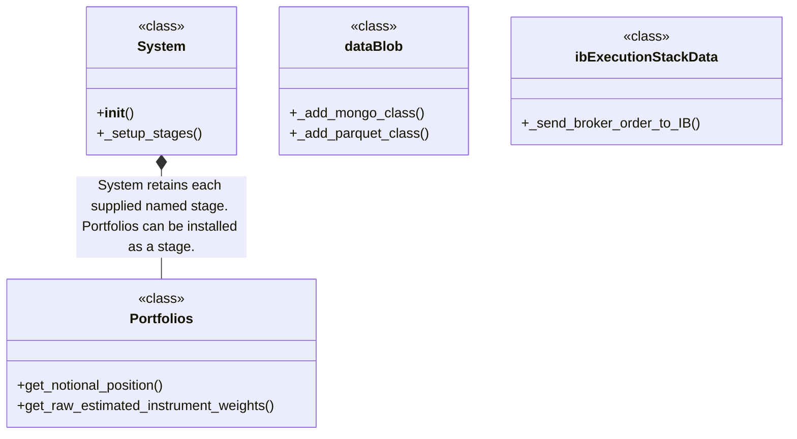
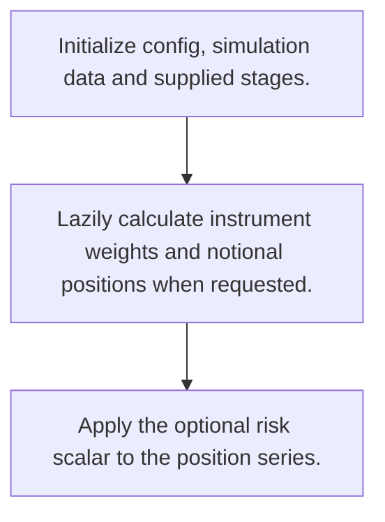
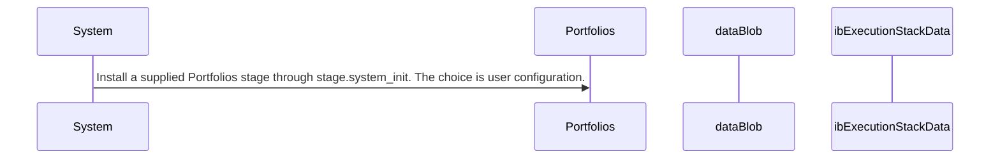

# pysystemtrade: workflow, design and architecture

Updated: **2026-10-13**
Reviewed Git hash: `cf3fa1828679dd8dff4779d30beba3c1c8a7cd63`
Branch: `feature/ayu_develop`
Source diff SHA256: `e3b0c44298fc1c149afbf4c8996fb92427ae41e4649b934ca495991b7852b855`
Scope: **Systematic futures framework** / Maintenance: **active**
Languages: Python

[HTML edition](ayu-develop.html) / [Development](development.md) / [Historical validation](validation.md) / [Full system comparison](../../docs/index.html)

## Purpose and scope

Compose lazy backtesting stages and operate separate production data and broker order pipelines.

## Features and support boundaries

Native = implemented here. Integration = supplied through a named host/API. Limited = material restriction. Not provided = evidenced scope exclusion. Unverified = support/absence not established. Not applicable = outside this artifact type.

| Capability | Status | Implementation and limits | Source |
|---|---|---|---|
| Backtesting | Native | Stage-composed systematic simulation context with cache and data source. | [System.__init__](../src/systems/basesystem.py) ([L42](https://github.com/alexcwyu/pysystemtrade/blob/cf3fa1828679dd8dff4779d30beba3c1c8a7cd63/src/systems/basesystem.py#L42)) / [System._setup_stages](../src/systems/basesystem.py) ([L85](https://github.com/alexcwyu/pysystemtrade/blob/cf3fa1828679dd8dff4779d30beba3c1c8a7cd63/src/systems/basesystem.py#L85)) / [Portfolios.get_notional_position](../src/systems/portfolio.py) ([L178](https://github.com/alexcwyu/pysystemtrade/blob/cf3fa1828679dd8dff4779d30beba3c1c8a7cd63/src/systems/portfolio.py#L178)) / [Portfolios.get_raw_estimated_instrument_weights](../src/systems/portfolio.py) ([L622](https://github.com/alexcwyu/pysystemtrade/blob/cf3fa1828679dd8dff4779d30beba3c1c8a7cd63/src/systems/portfolio.py#L622)) |
| Live execution | Integration | IB execution stack delegates futures contract orders to broker client. No live broker was contacted. | [ibExecutionStackData._send_broker_order_to_IB](../src/sysbrokers/IB/ib_orders.py) ([L334](https://github.com/alexcwyu/pysystemtrade/blob/cf3fa1828679dd8dff4779d30beba3c1c8a7cd63/src/sysbrokers/IB/ib_orders.py#L334)) |
| Paper trading | Unverified | The inspected source does not establish this capability. This is not a claim of absence. | Not applicable to this repository scope. |
| Event driven | Unverified | The inspected source does not establish this capability. This is not a claim of absence. | Not applicable to this repository scope. |
| Vectorized | Native | Historical position series are scaled and forward-filled using pandas. | [Portfolios.get_notional_position](../src/systems/portfolio.py) ([L178](https://github.com/alexcwyu/pysystemtrade/blob/cf3fa1828679dd8dff4779d30beba3c1c8a7cd63/src/systems/portfolio.py#L178)) / [Portfolios.get_raw_estimated_instrument_weights](../src/systems/portfolio.py) ([L622](https://github.com/alexcwyu/pysystemtrade/blob/cf3fa1828679dd8dff4779d30beba3c1c8a7cd63/src/systems/portfolio.py#L622)) |
| Order management | Integration | Broker execution stack returns placed order objects or missing_order to callers. | [ibExecutionStackData._send_broker_order_to_IB](../src/sysbrokers/IB/ib_orders.py) ([L334](https://github.com/alexcwyu/pysystemtrade/blob/cf3fa1828679dd8dff4779d30beba3c1c8a7cd63/src/sysbrokers/IB/ib_orders.py#L334)) |
| Order types | Limited | Order type and limit price are passed through to IB. Exact support requires the broker client/order definitions. | [ibExecutionStackData._send_broker_order_to_IB](../src/sysbrokers/IB/ib_orders.py) ([L334](https://github.com/alexcwyu/pysystemtrade/blob/cf3fa1828679dd8dff4779d30beba3c1c8a7cd63/src/sysbrokers/IB/ib_orders.py#L334)) |
| Multi venue | Unverified | The inspected source does not establish this capability. This is not a claim of absence. | Not applicable to this repository scope. |
| Crypto | Unverified | The inspected source does not establish this capability. This is not a claim of absence. | Not applicable to this repository scope. |
| Equities | Unverified | The inspected source does not establish this capability. This is not a claim of absence. | Not applicable to this repository scope. |
| Futures | Native | IB order submission resolves futures contract and contract data. | [ibExecutionStackData._send_broker_order_to_IB](../src/sysbrokers/IB/ib_orders.py) ([L334](https://github.com/alexcwyu/pysystemtrade/blob/cf3fa1828679dd8dff4779d30beba3c1c8a7cd63/src/sysbrokers/IB/ib_orders.py#L334)) |
| Options | Unverified | The inspected source does not establish this capability. This is not a claim of absence. | Not applicable to this repository scope. |
| Forex | Unverified | The inspected source does not establish this capability. This is not a claim of absence. | Not applicable to this repository scope. |
| Strategy api | Native | Named user-supplied stages initialized with shared system context. | [System.__init__](../src/systems/basesystem.py) ([L42](https://github.com/alexcwyu/pysystemtrade/blob/cf3fa1828679dd8dff4779d30beba3c1c8a7cd63/src/systems/basesystem.py#L42)) / [System._setup_stages](../src/systems/basesystem.py) ([L85](https://github.com/alexcwyu/pysystemtrade/blob/cf3fa1828679dd8dff4779d30beba3c1c8a7cd63/src/systems/basesystem.py#L85)) |
| Optimization | Native | Portfolio retrieves estimated instrument weights from configured optimizer. | [Portfolios.get_notional_position](../src/systems/portfolio.py) ([L178](https://github.com/alexcwyu/pysystemtrade/blob/cf3fa1828679dd8dff4779d30beba3c1c8a7cd63/src/systems/portfolio.py#L178)) / [Portfolios.get_raw_estimated_instrument_weights](../src/systems/portfolio.py) ([L622](https://github.com/alexcwyu/pysystemtrade/blob/cf3fa1828679dd8dff4779d30beba3c1c8a7cd63/src/systems/portfolio.py#L622)) |
| Machine learning | Unverified | The inspected source does not establish this capability. This is not a claim of absence. | Not applicable to this repository scope. |
| Reinforcement learning | Unverified | The inspected source does not establish this capability. This is not a claim of absence. | Not applicable to this repository scope. |
| Portfolio | Native | Instrument portfolio weights and notional position series. | [Portfolios.get_notional_position](../src/systems/portfolio.py) ([L178](https://github.com/alexcwyu/pysystemtrade/blob/cf3fa1828679dd8dff4779d30beba3c1c8a7cd63/src/systems/portfolio.py#L178)) / [Portfolios.get_raw_estimated_instrument_weights](../src/systems/portfolio.py) ([L622](https://github.com/alexcwyu/pysystemtrade/blob/cf3fa1828679dd8dff4779d30beba3c1c8a7cd63/src/systems/portfolio.py#L622)) |
| Risk management | Native | Optional risk scalar overlays notional portfolio positions. | [Portfolios.get_notional_position](../src/systems/portfolio.py) ([L178](https://github.com/alexcwyu/pysystemtrade/blob/cf3fa1828679dd8dff4779d30beba3c1c8a7cd63/src/systems/portfolio.py#L178)) / [Portfolios.get_raw_estimated_instrument_weights](../src/systems/portfolio.py) ([L622](https://github.com/alexcwyu/pysystemtrade/blob/cf3fa1828679dd8dff4779d30beba3c1c8a7cd63/src/systems/portfolio.py#L622)) |
| Performance analytics | Unverified | The inspected source does not establish this capability. This is not a claim of absence. | Not applicable to this repository scope. |
| Historical data | Unverified | The inspected source does not establish this capability. This is not a claim of absence. | Not applicable to this repository scope. |
| Streaming data | Unverified | The inspected source does not establish this capability. This is not a claim of absence. | Not applicable to this repository scope. |
| Persistence | Integration | dataBlob instantiates MongoDB and Parquet adapter classes. | [dataBlob._add_mongo_class](../src/sysdata/data_blob.py) ([L139](https://github.com/alexcwyu/pysystemtrade/blob/cf3fa1828679dd8dff4779d30beba3c1c8a7cd63/src/sysdata/data_blob.py#L139)) / [dataBlob._add_parquet_class](../src/sysdata/data_blob.py) ([L171](https://github.com/alexcwyu/pysystemtrade/blob/cf3fa1828679dd8dff4779d30beba3c1c8a7cd63/src/sysdata/data_blob.py#L171)) |
| Data pipeline | Native | Named stage installation plus adapter resolution. | [System.__init__](../src/systems/basesystem.py) ([L42](https://github.com/alexcwyu/pysystemtrade/blob/cf3fa1828679dd8dff4779d30beba3c1c8a7cd63/src/systems/basesystem.py#L42)) / [System._setup_stages](../src/systems/basesystem.py) ([L85](https://github.com/alexcwyu/pysystemtrade/blob/cf3fa1828679dd8dff4779d30beba3c1c8a7cd63/src/systems/basesystem.py#L85)) / [dataBlob._add_mongo_class](../src/sysdata/data_blob.py) ([L139](https://github.com/alexcwyu/pysystemtrade/blob/cf3fa1828679dd8dff4779d30beba3c1c8a7cd63/src/sysdata/data_blob.py#L139)) / [dataBlob._add_parquet_class](../src/sysdata/data_blob.py) ([L171](https://github.com/alexcwyu/pysystemtrade/blob/cf3fa1828679dd8dff4779d30beba3c1c8a7cd63/src/sysdata/data_blob.py#L171)) |
| Web ui | Unverified | The inspected source does not establish this capability. This is not a claim of absence. | Not applicable to this repository scope. |
| Cli | Unverified | The inspected source does not establish this capability. This is not a claim of absence. | Not applicable to this repository scope. |
| Monitoring | Unverified | The inspected source does not establish this capability. This is not a claim of absence. | Not applicable to this repository scope. |
| Extension api | Native | Supplied stages and storage/broker adapter classes. | [System.__init__](../src/systems/basesystem.py) ([L42](https://github.com/alexcwyu/pysystemtrade/blob/cf3fa1828679dd8dff4779d30beba3c1c8a7cd63/src/systems/basesystem.py#L42)) / [System._setup_stages](../src/systems/basesystem.py) ([L85](https://github.com/alexcwyu/pysystemtrade/blob/cf3fa1828679dd8dff4779d30beba3c1c8a7cd63/src/systems/basesystem.py#L85)) / [dataBlob._add_mongo_class](../src/sysdata/data_blob.py) ([L139](https://github.com/alexcwyu/pysystemtrade/blob/cf3fa1828679dd8dff4779d30beba3c1c8a7cd63/src/sysdata/data_blob.py#L139)) / [dataBlob._add_parquet_class](../src/sysdata/data_blob.py) ([L171](https://github.com/alexcwyu/pysystemtrade/blob/cf3fa1828679dd8dff4779d30beba3c1c8a7cd63/src/sysdata/data_blob.py#L171)) |
| Native acceleration | Unverified | The inspected source does not establish this capability. This is not a claim of absence. | Not applicable to this repository scope. |
| Distributed execution | Unverified | The inspected source does not establish this capability. This is not a claim of absence. | Not applicable to this repository scope. |

## System components

| Component | Responsibility | Source |
|---|---|---|
| System | Stage composition and lazy cached system context. | [System.__init__](../src/systems/basesystem.py) ([L42](https://github.com/alexcwyu/pysystemtrade/blob/cf3fa1828679dd8dff4779d30beba3c1c8a7cd63/src/systems/basesystem.py#L42)) / [System._setup_stages](../src/systems/basesystem.py) ([L85](https://github.com/alexcwyu/pysystemtrade/blob/cf3fa1828679dd8dff4779d30beba3c1c8a7cd63/src/systems/basesystem.py#L85)) |
| Portfolios | Instrument weights, diversification and position risk scaling. | [Portfolios.get_notional_position](../src/systems/portfolio.py) ([L178](https://github.com/alexcwyu/pysystemtrade/blob/cf3fa1828679dd8dff4779d30beba3c1c8a7cd63/src/systems/portfolio.py#L178)) / [Portfolios.get_raw_estimated_instrument_weights](../src/systems/portfolio.py) ([L622](https://github.com/alexcwyu/pysystemtrade/blob/cf3fa1828679dd8dff4779d30beba3c1c8a7cd63/src/systems/portfolio.py#L622)) |
| dataBlob | Production storage and broker adapter dependency resolution. | [dataBlob._add_mongo_class](../src/sysdata/data_blob.py) ([L139](https://github.com/alexcwyu/pysystemtrade/blob/cf3fa1828679dd8dff4779d30beba3c1c8a7cd63/src/sysdata/data_blob.py#L139)) / [dataBlob._add_parquet_class](../src/sysdata/data_blob.py) ([L171](https://github.com/alexcwyu/pysystemtrade/blob/cf3fa1828679dd8dff4779d30beba3c1c8a7cd63/src/sysdata/data_blob.py#L171)) |
| ibExecutionStackData | Interactive Brokers order integration. | [ibExecutionStackData._send_broker_order_to_IB](../src/sysbrokers/IB/ib_orders.py) ([L334](https://github.com/alexcwyu/pysystemtrade/blob/cf3fa1828679dd8dff4779d30beba3c1c8a7cd63/src/sysbrokers/IB/ib_orders.py#L334)) |

## Architecture and component boundaries

The component view summarizes inspected responsibility boundaries. Arrows identify the documented API/data dependencies; this is not a deployment-readiness claim.

- Install a supplied Portfolios stage through stage.system_init. The choice is user configuration.: [System.__init__](../src/systems/basesystem.py) ([L42](https://github.com/alexcwyu/pysystemtrade/blob/cf3fa1828679dd8dff4779d30beba3c1c8a7cd63/src/systems/basesystem.py#L42)) / [System._setup_stages](../src/systems/basesystem.py) ([L85](https://github.com/alexcwyu/pysystemtrade/blob/cf3fa1828679dd8dff4779d30beba3c1c8a7cd63/src/systems/basesystem.py#L85))

## Design decisions

| Decision | Rationale | Tradeoff | Evidence |
|---|---|---|---|
| Initialize stages once and calculate stage outputs lazily. | Shared System context and cache connect forecasting and portfolio computations. | The backtest stage flow and production broker stack are separate entry points. | [System.__init__](../src/systems/basesystem.py) ([L42](https://github.com/alexcwyu/pysystemtrade/blob/cf3fa1828679dd8dff4779d30beba3c1c8a7cd63/src/systems/basesystem.py#L42)) / [System._setup_stages](../src/systems/basesystem.py) ([L85](https://github.com/alexcwyu/pysystemtrade/blob/cf3fa1828679dd8dff4779d30beba3c1c8a7cd63/src/systems/basesystem.py#L85)) |
| Resolve storage classes through dataBlob naming and shared handles. | Production adapters receive consistent database/access/log objects. | Adapter constructors must follow expected naming and argument conventions. | [dataBlob._add_mongo_class](../src/sysdata/data_blob.py) ([L139](https://github.com/alexcwyu/pysystemtrade/blob/cf3fa1828679dd8dff4779d30beba3c1c8a7cd63/src/sysdata/data_blob.py#L139)) / [dataBlob._add_parquet_class](../src/sysdata/data_blob.py) ([L171](https://github.com/alexcwyu/pysystemtrade/blob/cf3fa1828679dd8dff4779d30beba3c1c8a7cd63/src/sysdata/data_blob.py#L171)) |

## Class and interface relationships

Each node is a reviewed source symbol. Function/module nodes are explicitly labeled; they do not imply Python classes. Only reviewed relationships are drawn.

- **System** (class): [System.__init__](../src/systems/basesystem.py) ([L42](https://github.com/alexcwyu/pysystemtrade/blob/cf3fa1828679dd8dff4779d30beba3c1c8a7cd63/src/systems/basesystem.py#L42)) / [System._setup_stages](../src/systems/basesystem.py) ([L85](https://github.com/alexcwyu/pysystemtrade/blob/cf3fa1828679dd8dff4779d30beba3c1c8a7cd63/src/systems/basesystem.py#L85))
- **Portfolios** (class): [Portfolios.get_notional_position](../src/systems/portfolio.py) ([L178](https://github.com/alexcwyu/pysystemtrade/blob/cf3fa1828679dd8dff4779d30beba3c1c8a7cd63/src/systems/portfolio.py#L178)) / [Portfolios.get_raw_estimated_instrument_weights](../src/systems/portfolio.py) ([L622](https://github.com/alexcwyu/pysystemtrade/blob/cf3fa1828679dd8dff4779d30beba3c1c8a7cd63/src/systems/portfolio.py#L622))
- **dataBlob** (class): [dataBlob._add_mongo_class](../src/sysdata/data_blob.py) ([L139](https://github.com/alexcwyu/pysystemtrade/blob/cf3fa1828679dd8dff4779d30beba3c1c8a7cd63/src/sysdata/data_blob.py#L139)) / [dataBlob._add_parquet_class](../src/sysdata/data_blob.py) ([L171](https://github.com/alexcwyu/pysystemtrade/blob/cf3fa1828679dd8dff4779d30beba3c1c8a7cd63/src/sysdata/data_blob.py#L171))
- **ibExecutionStackData** (class): [ibExecutionStackData._send_broker_order_to_IB](../src/sysbrokers/IB/ib_orders.py) ([L334](https://github.com/alexcwyu/pysystemtrade/blob/cf3fa1828679dd8dff4779d30beba3c1c8a7cd63/src/sysbrokers/IB/ib_orders.py#L334))

## Workflow

### Representative source-backed flow

The steps describe the inspected implementation. User configuration and data inputs are external prerequisites.

1. Initialize config, simulation data and supplied stages.. [System.__init__](../src/systems/basesystem.py) ([L42](https://github.com/alexcwyu/pysystemtrade/blob/cf3fa1828679dd8dff4779d30beba3c1c8a7cd63/src/systems/basesystem.py#L42)) / [System._setup_stages](../src/systems/basesystem.py) ([L85](https://github.com/alexcwyu/pysystemtrade/blob/cf3fa1828679dd8dff4779d30beba3c1c8a7cd63/src/systems/basesystem.py#L85))
2. Lazily calculate instrument weights and notional positions when requested.. [Portfolios.get_notional_position](../src/systems/portfolio.py) ([L178](https://github.com/alexcwyu/pysystemtrade/blob/cf3fa1828679dd8dff4779d30beba3c1c8a7cd63/src/systems/portfolio.py#L178)) / [Portfolios.get_raw_estimated_instrument_weights](../src/systems/portfolio.py) ([L622](https://github.com/alexcwyu/pysystemtrade/blob/cf3fa1828679dd8dff4779d30beba3c1c8a7cd63/src/systems/portfolio.py#L622))
3. Apply the optional risk scalar to the position series.. [Portfolios.get_notional_position](../src/systems/portfolio.py) ([L178](https://github.com/alexcwyu/pysystemtrade/blob/cf3fa1828679dd8dff4779d30beba3c1c8a7cd63/src/systems/portfolio.py#L178)) / [Portfolios.get_raw_estimated_instrument_weights](../src/systems/portfolio.py) ([L622](https://github.com/alexcwyu/pysystemtrade/blob/cf3fa1828679dd8dff4779d30beba3c1c8a7cd63/src/systems/portfolio.py#L622))

## Sequence

Representative calls and data dependencies

Messages represent inspected calls or explicitly labelled data dependencies. A data dependency is not an asserted direct runtime call.

- Install a supplied Portfolios stage through stage.system_init. The choice is user configuration.: [System.__init__](../src/systems/basesystem.py) ([L42](https://github.com/alexcwyu/pysystemtrade/blob/cf3fa1828679dd8dff4779d30beba3c1c8a7cd63/src/systems/basesystem.py#L42)) / [System._setup_stages](../src/systems/basesystem.py) ([L85](https://github.com/alexcwyu/pysystemtrade/blob/cf3fa1828679dd8dff4779d30beba3c1c8a7cd63/src/systems/basesystem.py#L85))

## Strengths and limits

### Strengths

- Simulation stages and production futures order objects have explicit boundaries. [System.__init__](../src/systems/basesystem.py) ([L42](https://github.com/alexcwyu/pysystemtrade/blob/cf3fa1828679dd8dff4779d30beba3c1c8a7cd63/src/systems/basesystem.py#L42)) / [System._setup_stages](../src/systems/basesystem.py) ([L85](https://github.com/alexcwyu/pysystemtrade/blob/cf3fa1828679dd8dff4779d30beba3c1c8a7cd63/src/systems/basesystem.py#L85)) / [ibExecutionStackData._send_broker_order_to_IB](../src/sysbrokers/IB/ib_orders.py) ([L334](https://github.com/alexcwyu/pysystemtrade/blob/cf3fa1828679dd8dff4779d30beba3c1c8a7cd63/src/sysbrokers/IB/ib_orders.py#L334))

### Limitations

- IB integration requires a configured broker connection and correctly resolved contract data. [ibExecutionStackData._send_broker_order_to_IB](../src/sysbrokers/IB/ib_orders.py) ([L334](https://github.com/alexcwyu/pysystemtrade/blob/cf3fa1828679dd8dff4779d30beba3c1c8a7cd63/src/sysbrokers/IB/ib_orders.py#L334))
- Static inspection of dataBlob is not validation of MongoDB/Parquet installations or persistent data correctness. [dataBlob._add_mongo_class](../src/sysdata/data_blob.py) ([L139](https://github.com/alexcwyu/pysystemtrade/blob/cf3fa1828679dd8dff4779d30beba3c1c8a7cd63/src/sysdata/data_blob.py#L139)) / [dataBlob._add_parquet_class](../src/sysdata/data_blob.py) ([L171](https://github.com/alexcwyu/pysystemtrade/blob/cf3fa1828679dd8dff4779d30beba3c1c8a7cd63/src/sysdata/data_blob.py#L171))

## Validation scope

The linked validation and command records preserve actual historical runs and user-authorized exclusions. This source/document review does not rerun application tests, establish live trading readiness or rank benchmark performance. Current data, credential and runtime prerequisites remain material.

[Repository validation](validation.md) / [Executed checks](maintenance/index.md)

## Source map

| Reviewed symbol/path | Inspected responsibility | Actual file SHA256 |
|---|---|---|
| [System.__init__](../src/systems/basesystem.py) ([L42](https://github.com/alexcwyu/pysystemtrade/blob/cf3fa1828679dd8dff4779d30beba3c1c8a7cd63/src/systems/basesystem.py#L42)) | Initializes data/config, installs supplied stages and creates a systemCache. | `3f2443690231f0ab4163775a7ede9742a29063d45c98bbc5bf80dfadec3d5d8a` |
| [System._setup_stages](../src/systems/basesystem.py) ([L85](https://github.com/alexcwyu/pysystemtrade/blob/cf3fa1828679dd8dff4779d30beba3c1c8a7cd63/src/systems/basesystem.py#L85)) | Calls each stage.system_init, rejects duplicate names and exposes stage instances as named system attributes. | `3f2443690231f0ab4163775a7ede9742a29063d45c98bbc5bf80dfadec3d5d8a` |
| [Portfolios.get_notional_position](../src/systems/portfolio.py) ([L178](https://github.com/alexcwyu/pysystemtrade/blob/cf3fa1828679dd8dff4779d30beba3c1c8a7cd63/src/systems/portfolio.py#L178)) | Gets the pre-risk notional position and applies a forward-filled risk scalar when configured. | `1c2d470f8479f4e98cdeae962ab830cd960df77ca5337586fa35e96d1fb015bc` |
| [Portfolios.get_raw_estimated_instrument_weights](../src/systems/portfolio.py) ([L622](https://github.com/alexcwyu/pysystemtrade/blob/cf3fa1828679dd8dff4779d30beba3c1c8a7cd63/src/systems/portfolio.py#L622)) | Obtains optimizer weights and restores configured zero weights. | `1c2d470f8479f4e98cdeae962ab830cd960df77ca5337586fa35e96d1fb015bc` |
| [dataBlob._add_mongo_class](../src/sysdata/data_blob.py) ([L139](https://github.com/alexcwyu/pysystemtrade/blob/cf3fa1828679dd8dff4779d30beba3c1c8a7cd63/src/sysdata/data_blob.py#L139)) | Instantiates a data adapter with shared Mongo connection and logger. | `5212571cb5d669140d1ffd48e425af6d4af8734405288581ac2b5a7adefc54c5` |
| [dataBlob._add_parquet_class](../src/sysdata/data_blob.py) ([L171](https://github.com/alexcwyu/pysystemtrade/blob/cf3fa1828679dd8dff4779d30beba3c1c8a7cd63/src/sysdata/data_blob.py#L171)) | Instantiates a data adapter with shared Parquet access and logger. | `5212571cb5d669140d1ffd48e425af6d4af8734405288581ac2b5a7adefc54c5` |
| [ibExecutionStackData._send_broker_order_to_IB](../src/sysbrokers/IB/ib_orders.py) ([L334](https://github.com/alexcwyu/pysystemtrade/blob/cf3fa1828679dd8dff4779d30beba3c1c8a7cd63/src/sysbrokers/IB/ib_orders.py#L334)) | Resolves a futures contract with IB data and calls broker_submit_order with trade list, account, order type and limit price. | `5d33ae9f8dbb566490f82b033c60a8b719768b16a4936e3a48769283796bc0df` |

## Documentation provenance

Review date: 2026-10-13. Full committed source HEAD: `cf3fa1828679dd8dff4779d30beba3c1c8a7cd63`. Template version: 2. 4 source files were independently hashed for this guide.

[Evidence catalog](../../docs/systems-2026-10-13/catalog.json) / [Standard template](../../docs/guidelines/APP_TEMPLATE.md)

- Snapshot provenance: inventory.json full HEAD cf3fa1828679dd8dff4779d30beba3c1c8a7cd63, branch feature/ayu_develop. Source was inspected in the existing checkout and no repository files were changed.
- Inspected implementation bodies and existing architecture documentation. This is a representative static source audit, not a runtime or live-service validation. Credential exclusions in current validation are policy, not evidence that a live connection succeeds.
- Inspected source files: src/systems/basesystem.py, src/systems/portfolio.py, src/sysdata/data_blob.py, src/sysbrokers/IB/ib_orders.py
- Read pysystemtrade/AGENTS.md, including prohibitions on AI PR management/review. This task creates evidence outside the repository, with no PR operations.
