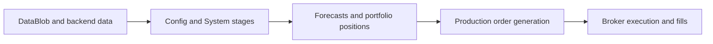
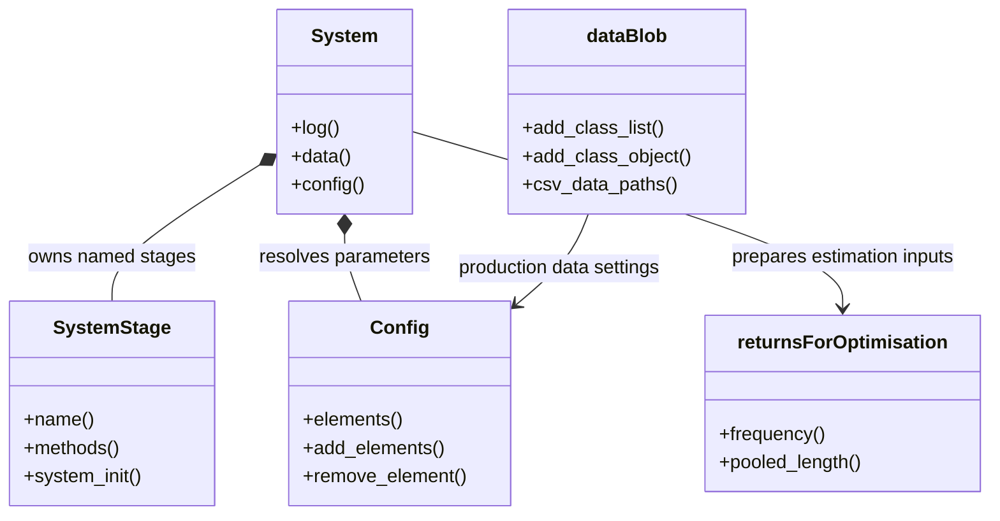
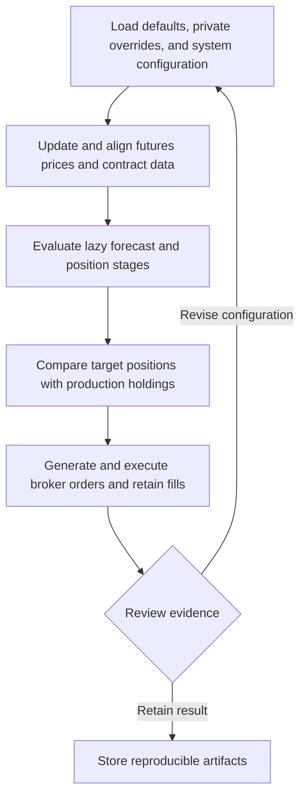
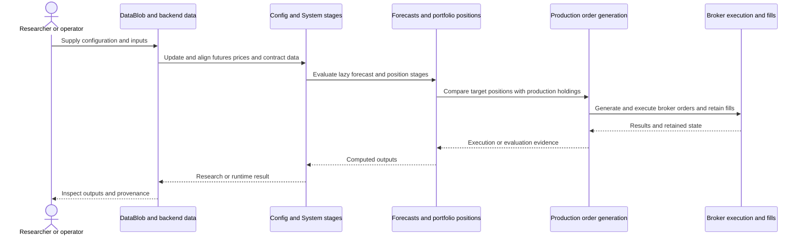
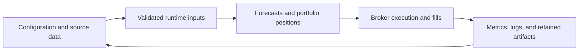
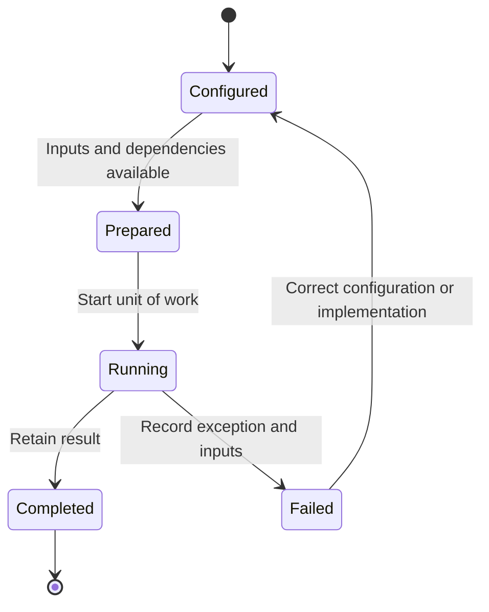

# PySystemTrade: workflow and architecture

Updated 2026-10-12. Source baseline: `8fec4f3530fa09a1c29bf06ca64a1dd0b53fde43` on `feature/ayu_develop`. See [development commands](development.md) and [validation evidence](validation.md) for the tested environment and current limitations.

## Purpose and features

Builds systematic futures portfolios and operates a production pipeline covering data updates, forecasts, risk sizing, target positions, and Interactive Brokers execution.

- Lazy staged backtesting systems
- Forecast scaling, combination, sizing, and portfolio stages
- Futures contracts, rolls, prices, and fills
- CSV, MongoDB, and Parquet data abstractions
- Production process control and broker order stacks

## Component architecture

System composes stages and evaluates their cached outputs lazily. Config layers defaults and user overrides, while dataBlob resolves backend-specific classes into canonical data attributes. Domain objects represent contracts, rolls, fills, and prices. Production is deliberately staged: daily price updates precede adjusted prices and system target generation, while stack handling and monitoring run during trading hours. Quantitative estimation and optimisation remain separate from broker transport.

The diagram shows responsibility boundaries in the main research or execution path. Concrete entry points and implementation files are linked below.

## Core types

The types below belong to the public or native boundary described by the linked implementation. Arrows describe the dependency or ownership relationship used in the documented workflow. Listed Python methods are present in the linked source; native array types represent the binding boundary.

## End-to-end workflow

1. Load defaults, private overrides, and system configuration.
2. Update and align futures prices and contract data.
3. Evaluate lazy forecast and position stages.
4. Compare target positions with production holdings.
5. Generate and execute broker orders and retain fills.

## Interaction sequence

The sequence follows one unit of work. Results return across the same boundaries that accepted the configuration and data. External I/O and numerical execution have different failure modes and should retain separate evidence.

## Data and artifact lifecycle

Inputs include explicit strategy or model settings, data selection, and execution assumptions. Retaining these with outputs makes a rerun reviewable. Temporary environments and caches remain development artifacts, while source-controlled configuration documents intended behavior.

## Execution and failure boundaries

MongoDB, Interactive Brokers, private configuration, and production state are external requirements. The maintained broker package is ib_async. Pandas subclasses must preserve custom frequency and pooling metadata during multiprocessing and serialization. Calendar-frequency aliases and scalar-return conventions also affect doctest and research compatibility.

This state diagram describes the documented workflow, not a claim that these names are an implementation enum. Failure evidence should identify whether input preparation, external services, native compilation, or application execution failed.

## Development layout

The multi-package src/ layout remains intact. New upstream sysquant and broker tests were moved into their corresponding src packages. Hatchling includes the sys* packages, systems, and data assets.

## Source map

| Existing source | Responsibility evidence |
|---|---|
| [src/systems/basesystem.py](../src/systems/basesystem.py#L25) | Implementation and module/type documentation, beginning at line 25 |
| [src/systems/stage.py](../src/systems/stage.py#L6) | Implementation and module/type documentation, beginning at line 6 |
| [src/sysdata/config/configdata.py](../src/sysdata/config/configdata.py#L37) | Implementation and module/type documentation, beginning at line 37 |
| [src/sysdata/data_blob.py](../src/sysdata/data_blob.py#L14) | Implementation and module/type documentation, beginning at line 14 |
| [src/systems/forecast_scale_cap.py](../src/systems/forecast_scale_cap.py#L16) | Implementation and module/type documentation, beginning at line 16 |
| [src/systems/forecast_combine.py](../src/systems/forecast_combine.py#L45) | Implementation and module/type documentation, beginning at line 45 |
| [src/systems/positionsizing.py](../src/systems/positionsizing.py#L20) | Implementation and module/type documentation, beginning at line 20 |
| [src/systems/portfolio.py](../src/systems/portfolio.py#L69) | Implementation and module/type documentation, beginning at line 69 |
| [src/sysquant/returns.py](../src/sysquant/returns.py#L14) | Implementation and module/type documentation, beginning at line 14 |
| [src/sysquant/optimisation/optimise_over_time.py](../src/sysquant/optimisation/optimise_over_time.py#L14) | Implementation and module/type documentation, beginning at line 14 |
| [src/sysbrokers/IB/ib_orders.py](../src/sysbrokers/IB/ib_orders.py#L34) | Implementation and module/type documentation, beginning at line 34 |
| [src/sysobjects/contracts.py](../src/sysobjects/contracts.py#L22) | Implementation and module/type documentation, beginning at line 22 |
| [src/syscore/pandas/frequency.py](../src/syscore/pandas/frequency.py#L21) | Implementation and module/type documentation, beginning at line 21 |

The links target files present in this checkout. Follow their imports and adjacent tests when changing a boundary. The validation document distinguishes successful builds, complete test runs, inherited skips, and unresolved prerequisites.
